# E-Rechnungen

Zunehmend mehr Tierärzte kontaktieren uns bzgl. Fragen und Unsicherheiten zum Thema E Rechnung. Hierbei sind die hier gestellten
Informationen die, die wir selbst von unserem Steuerberater sowie Collmex erhalten haben und in steuerlichen Texten recherchiert haben.

Wichtig ist auch, die Pflicht zwischen emfangen von E-Rechnungen dem Erstellen von E-Rechnungen zu verstehen. Die Texte hier sollen dabei helfen.

Diese sind somit ohne Gewährleistung, bei weiteren Fragen kontaktieren Sie bitte Ihren Steuerberater!

##  E-Rechnungspflicht auch für Ihre Praxis?

Zunächst einmal muss klar sein, dass von der E-Rechnungspflicht (dem Erstellen von E-REchnungen) nur der sogenannte B2B (business to business) Sektor betroffen ist.
Das bedeutet also Umsätze, die zwischen Unternehmen erfolgen. Eine Tierarztpraxis ist in den meisten Fällen immer ein sog.   
B2C Geschäft (Also business to customer, also Geschäft mit einem Endkunden im Sinne einer Privatperson)

Außerdem gilt noch eine Frist mit einer Übergangslösung bis Ende 2027, ab der es "Ernst" wird. Bis zu dieser Frist sind "normale" Rechnungen erlaubt, wenn der Empfänger der
Rechnung (also das Unternehmen, an das die Rechnung geht) damit einverstanden ist und diesem nicht widerspricht.

Die Frist mit der Übergangslösung endet für all jene schon zum 1.1.2027, deren Umsatz aus dem B2B Sektor 800.000 Euro überschreitet.

Bis Ende 2026 sind also erst einmal alle Unternehmen "sicher", sofern der Rechnungsempfänger mit der "alten" Rechnung einverstanden ist.

## Eingangsrechnungen

Grundsätzlich können sowohl Datev als auch Collmex bereits mit E Rechnungen arbeiten, wenn Sie also Belege an Ihren Steuerberater weiterleiten, stellt
dies kein Problem dar, wenn diese ab 1.1.2025 das E-Rechnungsformat haben. Auch über Collmex können diese problemlos verbucht werden.

Eine Verwaltung der Eingangs-E-Rechnungen in unseren Lieferantenrechnungen ist zum aktuellen Zeitpunkt nicht geplant. Die Buchungssätze der 
entstehenden Kosten können dennoch ganz normal gebucht werden- sollte es Probleme geben, kontaktieren Sie uns gern.   

## E- Rechnungen im debevet erstellen  

Für alle, die unter die B2B Regelung fallen und/oder auch vor der gesetzlichen Pflicht E-Rechnungen versenden wollen, bieten wir ab ca. Dezember 2026
eine Möglichkeit hierfür.   

Dies erfolgt über die Zubuchung einer gesonderten Schnittstelle von Fiskaly. Dieser Anbieter ist einer der größten am europäischen Markt und 
deckt alle Bestimmungen rechtssicher ab, so dass Sie beruhigt arbeiten können.   

Die Schnittstelle kann für 16,95 Euro netto pro Monat zugebucht werden. Wir haben uns für diesen Weg entschieden, da wir aktuell 
keine globale Preiserhöhung für ALLE Nutzer wünschen, sondern schnelle und rechtlich sichere Lösungen bieten wollen für die Nutzer, die es
sofort brauchen und wollen.   
 
:::caution  Achtung  

Wir bitten zu berücksichtigen, dass die Rechnungserstellung etwas komplexer werden kann und gewisse Daten am Kunden hinterlegt sein müssen.  
Dies ist keine Schikane oder von uns so gewählt, sondern eine rechtliche Vorgabe.   

:::   

## Die E-Rechnungs-Schnittstelle aktivieren  

Klicken Sie auf die Zahnräder links in der Hauptleiste und dann "Erweiterungen".  

Dort sehen Sie im Bereich "Buchhaltung" die neue Kachel "Fiskaly E-Rechnung". 
Klicken Sie dort auf "Buchen".  

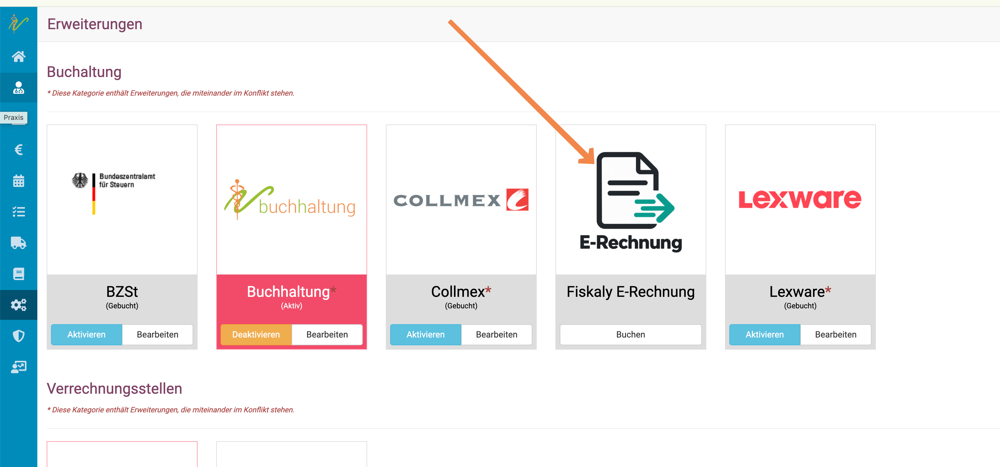  

Sie werden direkt zur Buchungsseite geleitet und müssen einmal bestätigen, dass Sie in Ihrem aktuellen Paket diese Erweiterung
kostenpflichtig zubuchen wollen.   

Klicken Sie dazu dann an Ihrem Paket auf "ändern" (die Voreinstellung ist bereits so, dass der Haken für die Erweiterungsbuchung 
gesetzt ist, im Screenshot in einem Nutztierpaket).   

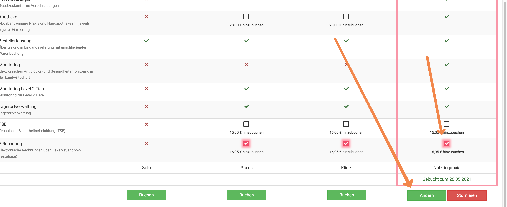   

Sie werden nun weitergeleitet in den "Kundenkonto-Übersichts-Bereich". Um zurück zum Programm zu gelangen, klicken Sie unten links auf das 
Symbol mit dem Pfeil auf eine "Tür". 

Wenn Sie anschließend erneut auf die Erweiterungen zugreifen, hat sich die Kachel geändert und Sie können die Erweiterung nun "anlegen".   

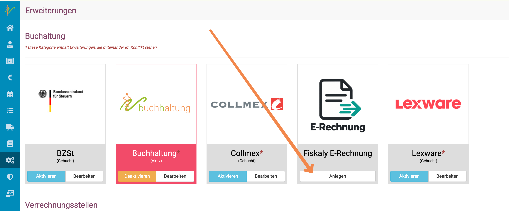   

Falls Sie Ihre Umsatzsteuer ID noch nicht eingetragen haben, fordert das Programm diese nun:   

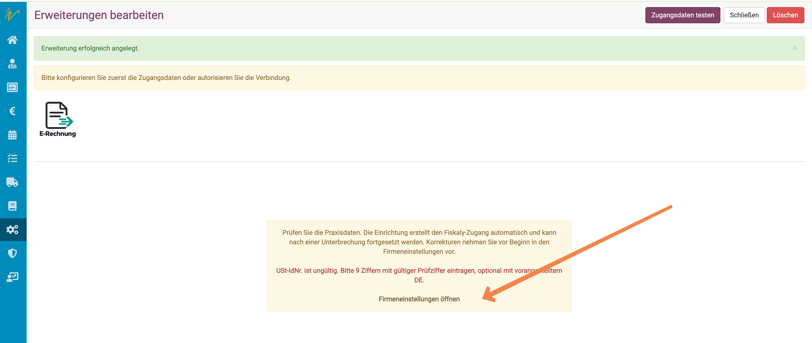   

Wenn Sie auf "Firmeneinstellungen öffnen" klicken, leitet debevet Sie direkt dorthin.   

Nach Eingabe dieser kann die Einrichtung fortgesetzt werden.   
 
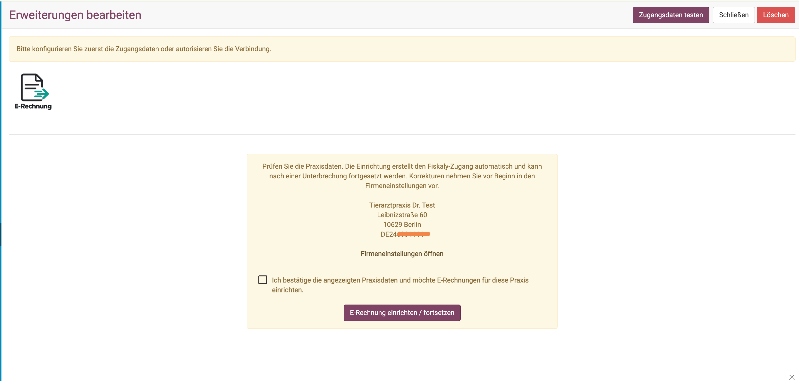   

Sie können nun in der Einrichtung entscheiden, ob Sie die Rechnungen immer an den Empfänger senden wollen oder an eine alternative 
Adresse. Wenn der Empfänger als Standard gesetzt werden soll, füllen Sie hier nichts aus.   
 
Ebenso können Sie hier entscheiden, welches E-Rechnungs Format Sie als Standard setzen wollen. Dies betrifft nur die Vorauswahl, 
Sie können vor dem späteren Versenden für jeden Kunden auch noch einmal ändern.   

Zur Auswahl stehen das ZugPferd Format und XML Format    

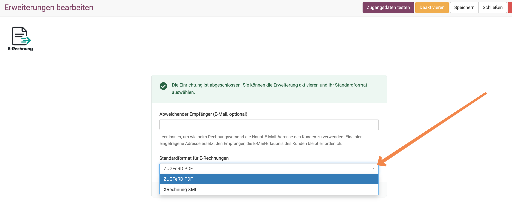  
 
Wenn Sie alles eingerichtet haben, klicken Sie oben rechts "Speichern" und dann "Aktivieren".      

### Umsatzsteuer ID Pflicht bei E-Rechnung   

Um eine E-Rechnung erstellen zu können, müssen Sie an all Ihren Kunden eine Umsatzsteuer ID hinterlegen, wenn diese Kunden 
eine E-Rechnung erhalten sollen. Ebenso ist die Angabe der vollen Adresse und des Landes Pflicht.  

:::caution Achtung!  

Bitte beachten Sie, dass aktuell die E-Rechnungspflicht nur innerhalb Deutschlands besteht. Ausländischen Kunden soll und muss 
weiterhin eine normale Reverse-Charge Rechnung ausgestellt werden. Eine Erstellung von E-Rechnung ist für diese Kunden nicht möglich.   

:::   

Damit Sie schnell und einfach prüfen können, bei welchen Kunden noch Daten fehlen und können hier direkt zum Kunden "springen",
um die Daten zu ergänzen. Diese Übersicht finden Sie in der Erweiterung.   

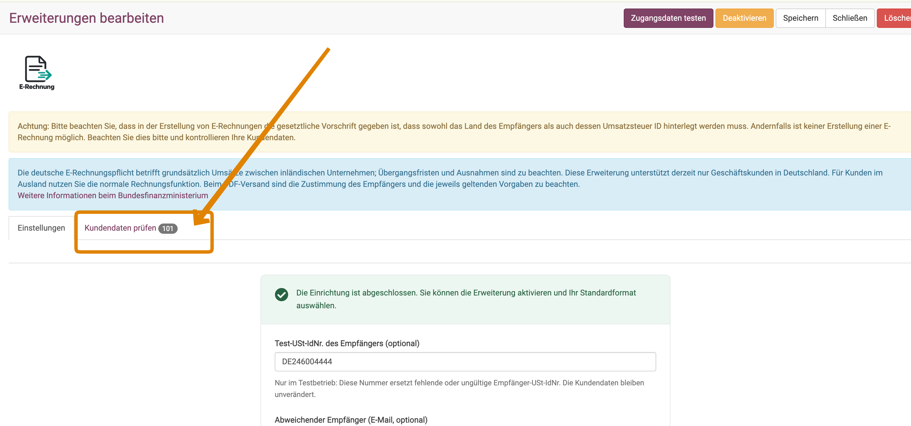  

### Abweichendes Format am Kunden

Für einzelne Kunden, die ein anderes Format als das Praxisformat wünschen, können Sie dies am Kunden unter dem Reiter
"Allgemein" mit festlegen. Anschließend klicken Sie oben rechts auf "Speichern".    

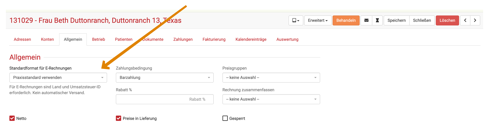

## E-Rechnung anlegen und verschicken  

Sie haben nun an jeder Rechnung die Möglichkeit, diese wie zuvor als "normale" pdf zu erstellen und zu versenden, wie zuvor.   

Wenn Sie nun gewerbliche Kunden haben oder generell eine E- Rechnung erstellen wollen, können Sie nach dem Anlegen der Rechnung(en) 
an der Rechnung selbst nun festlegen, dass diese als E-REchnung versandt werden soll.   

In der Rechnungs-Detailansicht haben Sie den Button "E-Rechnung"   

:::caution   
Dieser Button wird IMMER erst sichtbar, wenn die Rechnung angelegt wurde!

:::

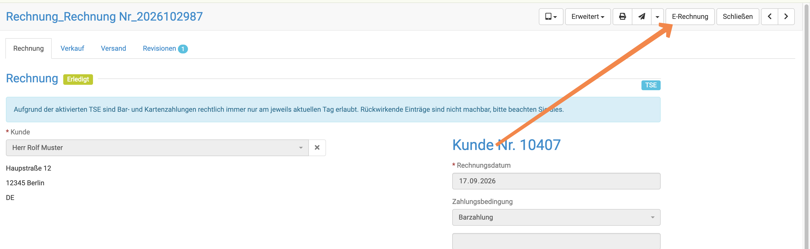     

Wenn Sie diesen klicken, können Sie erneut sehen, an wen diese Rechnung verschickt wird und noch einnmal das Format ändern, 
wenn dies gewünscht ist.   

Passen Sie die Einstellungen nach Wunsch an (gültig für diese eine Rechnung) und klicken dann auf "E-Rechnung erstellen und versenden".   

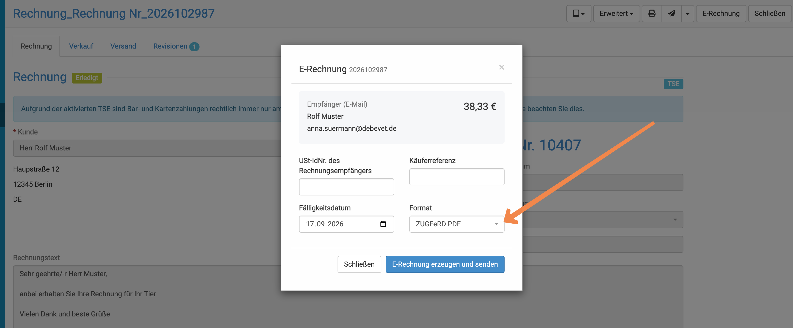  

Sollten noch Daten fehlen, wird Ihnen genau angezeigt, was fehlt.      

:::danger Achtung  

Wenn Sie das XRechnungs-Format wählen, erfordert dieses gesetzliche auch die Telefonnummer des Kunden sowie bei jeder Rechnung eine
Käuferreferenz. Diese müssen Sie dann jedes mal hinterlegen, wenn Sie dieses Format nutzen möchten.   

:::   

## Monatliche Rechnungen/ Sammelrechnungen als E-Rechnung erstellen   

Da die meisten der betroffenen Praxen nur monatlich Sammelrechnungen erstellen, soll dieses Thema hier berücksichtigt werden. 

Bitte bedenken Sie, dass es zu vielen Problemen und Fehlermeldungen kommen kann, wenn Daten an Ihren Kunden fehlen. Wir empfehlen dringend,
die Kundendaten über die Erweiterung prüfen zu lassen und zunächst alle Daten zu ergänzen, damit die Massenabrechnung nicht in 
einem absoluten Chaos endet.   

Wir empfehlen auch, die ersten zwei Monate evtl. doch lieber häufiger abzurechnen, damit auch wir bei evtl. Problemen Zeit haben, zu reagieren und
evtl. Bugs zu fixen.  

Zunächst erstellen Sie die Rechnungen für die Kunden ganz "normal", wie Sie dies immer erledigt haben. 

Nun klicken Sie in die Rechnungsliste und markieren alle Kunden, die eine E-Rechnung erhalten sollen. Sie können dazu auch nach dem 
Datum der Rechnungsstellung filtern, um nicht alle Rechnungen, sondern nur die soeben neu erstellten zu sehen.  

:::tip Tipp 
Wenn Sie Kunden haben, bei denen KEINE E-Rechnung erstellt werden soll/kann, können Sie bei diesen auch bei am Kunden unter 
"Allgemein" bei der E-Rechungsvariante "keine E-Rechnung" wählen. Diese Kunden werden dann im folgenden Schritt ausgelassen.  

:::   

Klicken Sie nun auf den Button "E-Rechnung"  

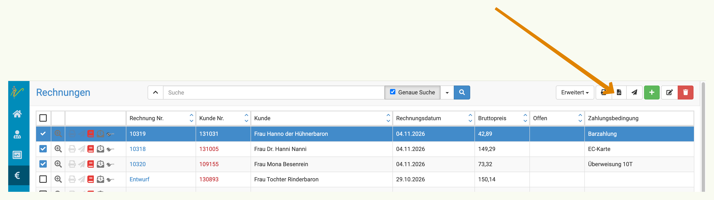   

Sie sehen nun eine Übersicht, wie viel der Rechnungen erfolgreich in eine E-Rechnung überführt werden konnten und wie viele übersprungen wurden.   

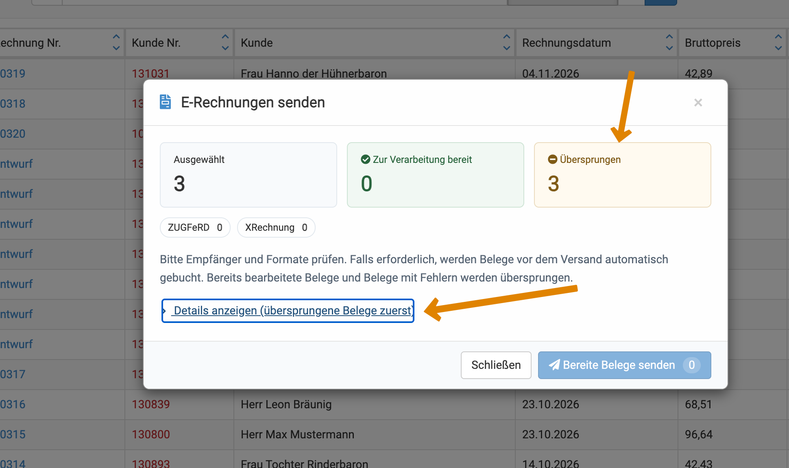  

Dort können Sie auf Details klicken und die Einzelheiten erkennen, warum bei welcher Rechnung die Erstellung gescheitert ist.  

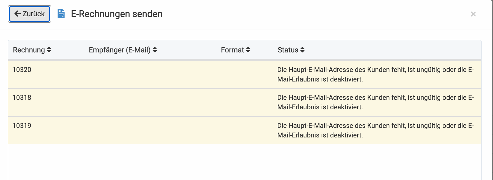  

Wenn Sie die Probleme beheben, können Sie diese Rechnungen dann erneut als E-Rechnungen erstellen.  

:::caution Achtung  

Uns ist klar, dass dies teilweise mühsam und zeitaufwändig sein kann, aber leider sind wir gewzungen, die rechtlichen Vorgaben 
zu erfüllen. Bitte sehen Sie davon ab, uns zu kontaktieren, um Beschwerden dazu einzureichen, wir danken vorab.   

:::   

## E-Rechnungen löschen  

Eine E-Rechnung kann genauso gelöscht werden, wie jede andere Rechnung auch- mit einem Unterschied: Das Gesetz sieht vor, dass 
immer eine "Gutschrift" also Stornorechnung erzeugt und automatisch an den Kunden verschickt wird.   

Das bedeutet, dass bei jeder gelöschten E-Rechnung Ihr Kunde automatisch einen Stornobeleg erhält. Um Verwirrungen bei Ihren Kunden zu vermeiden,
empfehlen wir deshalb, vor dem Erstellen der E-Rechnung diese besonders gut zu prüfen.   

Klicken Sie auf "Rechnung stornieren", um den Prozess durchzuführen.   

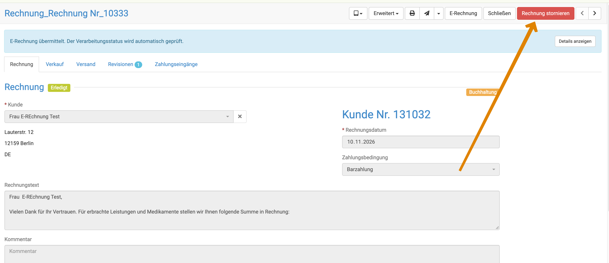
  
Sollten es bereits bezahlte Rechnungen sein, muss wie immer zunächst der Zahlungsbeleg gelöscht werden, damit die geesamte Rechnung 
storniert werden kann.  

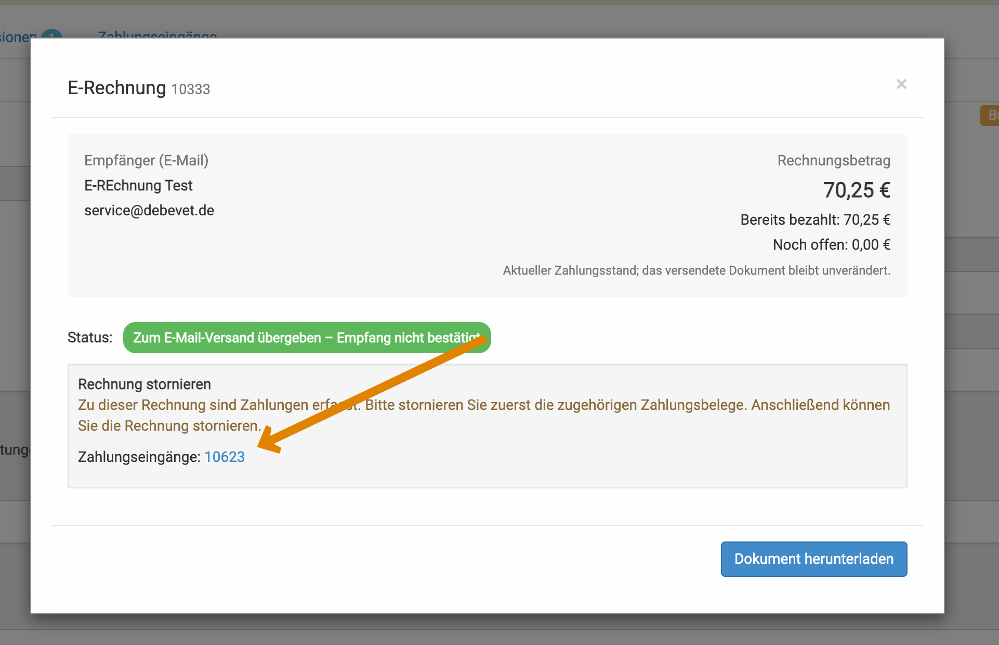  

Die Stornierung muss dort noch einmal bestätigt werden.   

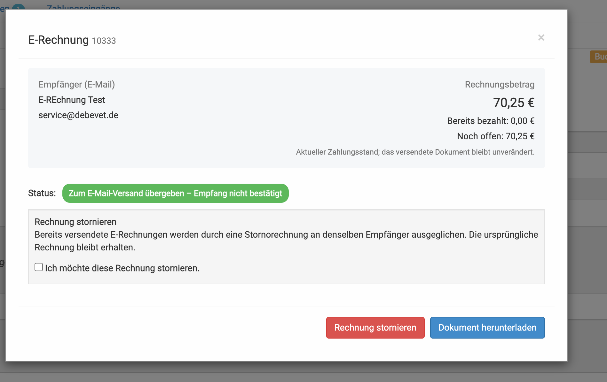  

Dann ist eine erneut "Überprüfen und Stornierung fortsetzen" Bestätigung nötig. Klicken Sie dazu dann erneut den Button.   

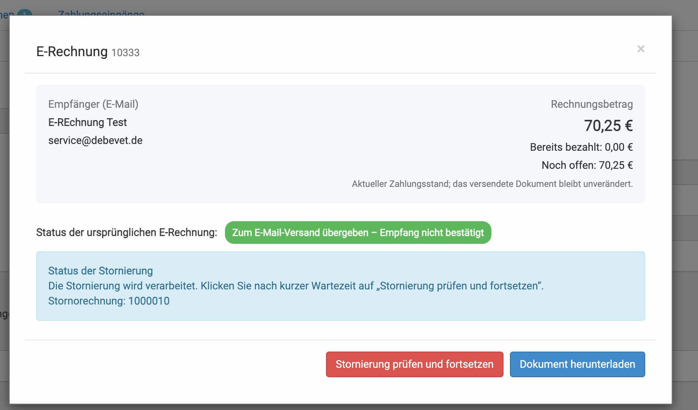  

Nun ist der Prozess abgeschlossen und der Kunde erhält automatisch die Stornorechnung. 

## E-Rechnungen und Mahnungen   

Gesetzlich müssen Mahnungen nicht im E-Rechnungsformat erstellt werden. Das bedeutet, dass Sie wie bisher die Mahnungen ganz normal erstellen 
können. 

:::caution Achtung   

Bitte beachten Sie, dass zu jeder Rechnung immer zuerst die E-Rechnung erstellt werden MUSS und dann eine Mahnung. 
Ist bereits eine Mahnung erstellt, kann KEINE E-Rechnung zu der zugehörigen Rechnung mehr erzeugt werden.   

:::